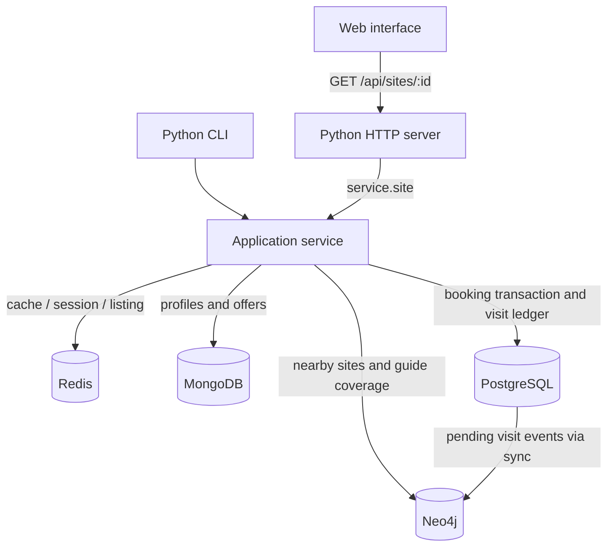
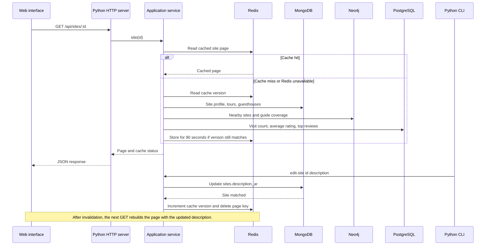

# معمارية التشغيل

## طلب صفحة موقع وتعديل وصفها

يُنفّذ `edit-site` عبر CLI. عندما يكون Redis متاحًا، ينفّذ سكربت Lua زيادة الإصدار وحذف المفتاح `site:<id>:page` ذريًا. يمنع الإصدار طلبًا بدأ قبل الإبطال من تخزين الصفحة القديمة بعده.

**قراءة الصفحة.** يفحص التطبيق Redis أولًا. عند غياب الصفحة يجمع مستند الموقع والجولات والإقامات، ثم يجتاز علاقات القرب والتغطية، ويحسب عدد أحداث الزيارة ومتوسط التقييم مستقلين كي لا تتضاعف الصفوف. يعيد أعلى خمسة تقييمات مع نصها ويخزن الصفحة العامة 90 ثانية. إذا تعذر Redis، تظهر حالة bypass. إذا فشل مصدر أساسي أثناء تركيب الصفحة، يرجع الأمر رمز خروج غير صفري.

**كتابة الحجز.** يقرأ التطبيق العرض والموقع والمرشد من MongoDB. يسجل PostgreSQL معرّفاتها مع الحجز في معاملة واحدة محلية. قد يتغير الكتالوج بين التحقق والكتابة. تتعامل النسخة الصفية مع كتالوج ثابت وتمنع مسارات الحذف العامة، ويفحص audit المراجع.

**اكتمال الزيارة.** يقفل التطبيق صف الحجز ثم يحدّث الحالة ويسجل حدثًا فريدًا داخل المعاملة نفسها. بعد الالتزام يبطل صفحة الموقع ويسقط الحدث على علاقة VISITED. يكتب sync آخر تاريخ معروف على العلاقة باستخدام MERGE. علامة projected في سجل SQL تسمح بإعادة المحاولة بعد تعطل الشبكة أو بعد كتابة الرسم وقبل تحديث العلامة. الزيارات المتكررة إلى الموقع تُحفظ كلها في SQL.

**حدود الفشل.** قد يتأخر ظهور العلاقة حتى تشغيل sync. وإذا تعذّر الوصول إلى Redis أثناء الإبطال ثم عاد وبقيت نسخته القديمة، تنتهي صلاحيتها خلال 90 ثانية. رقم الجيل يمنع قارئًا بدأ قبل تعديل ناجح من إعادة تخزين نسخة سبق إبطالها. يتم إصلاح إسقاط زائر مسجل بتشغيل sync أيضًا.

## نتائج تجربة Redis

أعدّ هذا القسم مؤيد، وهو يوثّق أثر Redis على صفحة الموقع.

نُفّذت التجربة في 24 نوفمبر 2026 على نسخة جديدة من `main` عند `02f4a4d`، ببيانات فارغة ثم `seed`. Docker غير متوفر على جهاز التحقق، فشُغّلت PostgreSQL 16.6 وMongoDB 7.0.28 وNeo4j 5.26.0 وRedis 5.0.14.1 أصليًا على Windows بمنافذ ومجلدات بيانات معزولة عن نسخة العرض. نُفّذت أوامر `atlas.py` نفسها التي تشغّلها حاوية `app`، وأوقفت عملية Redis نفسها بدل `docker compose stop redis`. لم تُجرّب أوامر Compose نفسها.

الموقع المستخدم: البلدة القديمة في الخليل `00000000-0000-0000-0000-0000001e8481`. نجحت اختبارات التكامل الأحد عشر قبل أي حجز يدوي، وأعاد `audit` النتيجة `references: ok` لتسعة مواقع في البداية والنهاية.

### القراءة والإبطال

| الخطوة | المتوقع | حالة الذاكرة الفعلية | زيارات / متوسط |
|---|---|---|---|
| القراءة الأولى بعد `seed` | miss | miss | 3 / 4.00 |
| القراءة الثانية | hit | hit، وبقية الرد مطابقة للأولى | 3 / 4.00 |
| بعد طلب الحجز ثم تأكيده | hit، لا تتغير الصفحة | hit | 3 / 4.00 |
| القراءة الأولى بعد إكمال الحجز | miss | miss | 4 / 4.00 |
| القراءة الثانية بعد الإكمال | hit | hit | 4 / 4.00 |
| القراءة الأولى بعد تقييم 5 نجوم | miss | **miss** | 4 / **4.25** |
| القراءة الثانية بعد التقييم | hit | hit | 4 / 4.25 |

حتى نميّز الإبطال من انتهاء المهلة، قرأنا `cache-info` قبل التقييم مباشرة: النسخة القديمة محفوظة (2311 بايت) وبقي لها 87 ثانية من 90. بعد التقييم مباشرة صار حجم المفتاح 0 وقيمة TTL ‎-2، أي أن `add-review` حذف النسخة. المتوسط يطابق الحساب (5+4+3+5) ÷ 4 = 4.25.

عند قياس `service.site` داخل عملية واحدة (20 قراءة لكل حالة) كان الوسيط 45.1 مللي ثانية عند miss و0.2 عند hit. زمن أمر CLI الكامل لا يصلح للمقارنة لأن معظمه بدء Python والاتصالات.

### توقف Redis وحدها

| الفحص أثناء التوقف | النتيجة |
|---|---|
| `site` من سطر الأوامر | رمز خروج 0، `bypass`، ورجعت جولتان وبيت ضيافة ومرشدان (سليم ثم ريم) وموقعان قريبان و4 زيارات بمتوسط 4.25 و4 مراجعات |
| `listing` | `bypass` مع الجولات |
| زمن `service.site` | وسيطه 3071 مللي ثانية مقابل 45 عند miss، لأن القراءة تنتظر ثلاث محاولات اتصال مهلة كل منها ثانية |
| `cache-info` | خطأ اتصال، وهو متوقع لأنه أمر فحص للذاكرة نفسها |
| `/api/catalog` و`/api/analytics` | 200 |
| `/api/me` لزائر بلا جلسة | 200 |
| `/api/me` و`/api/bookings` لزائر سجّل دخوله، و`/api/login` | 503، لأن الجلسات محفوظة في Redis |

بعد إعادة تشغيل Redis كانت القراءة الأولى miss والثانية hit بالأرقام نفسها. انتهت الجلسات المفتوحة لأن التشغيل الأصلي يستخدم `--save ""`، ويلزم تسجيل الدخول من جديد. الحجوزات والتقييمات بقيت في PostgreSQL. في Compose قد تحتفظ صورة Redis بنسخة عند الإيقاف المنظّم، ولم يُتحقق من ذلك هنا.

### ما غيّرته النتيجة

- كانت الواجهة تعرض صفحة خطأ كاملة لكل زائر يحمل جلسة عند توقف Redis، لأن `/api/me` شرط لتحميل الدليل. صار فشل الجلسة تنبيهًا مستقلًا، ويبقى تصفّح المواقع والإحصاءات متاحًا. انتهاء الجلسة يعيد الزائر إلى شاشة الدخول.
- تعرض صفحة الموقع قسم «كيف وصلتك هذه الصفحة؟» بحالة الذاكرة وزمن كل قراءة. على المتصفح والخدمات الفعلية: miss بزمن 57 مللي ثانية، ثم hit بزمن 15 و7.8، ثم bypass بزمن 3115 عند توقف Redis.
- مهلة الثواني الثلاث بقيت كما هي. يمكن تقليلها بتخطي Redis لفترة قصيرة بعد أول فشل في القراءة، دون تخطي محاولة الإبطال حتى لا تبقى نسخة قديمة.
